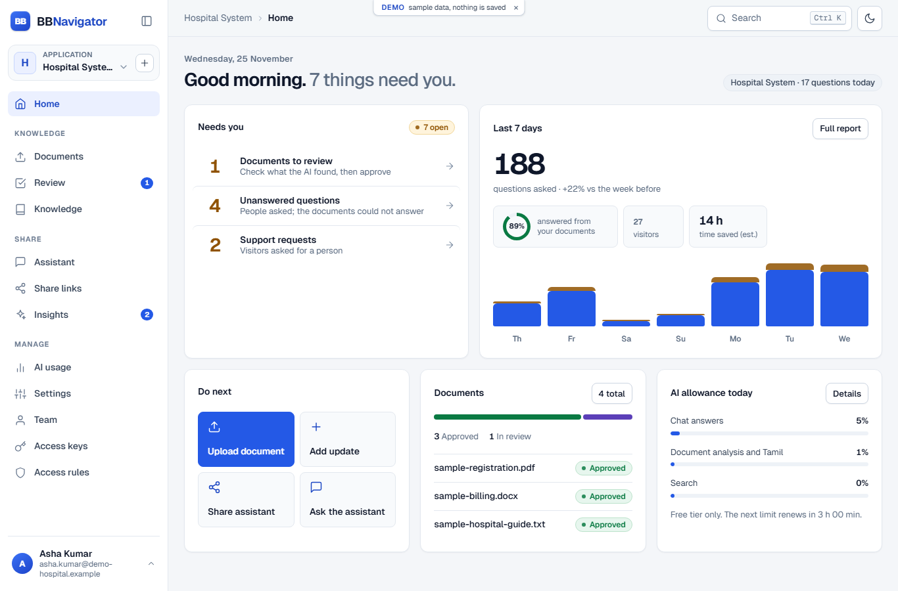
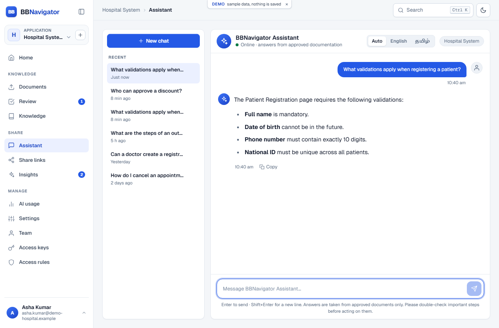
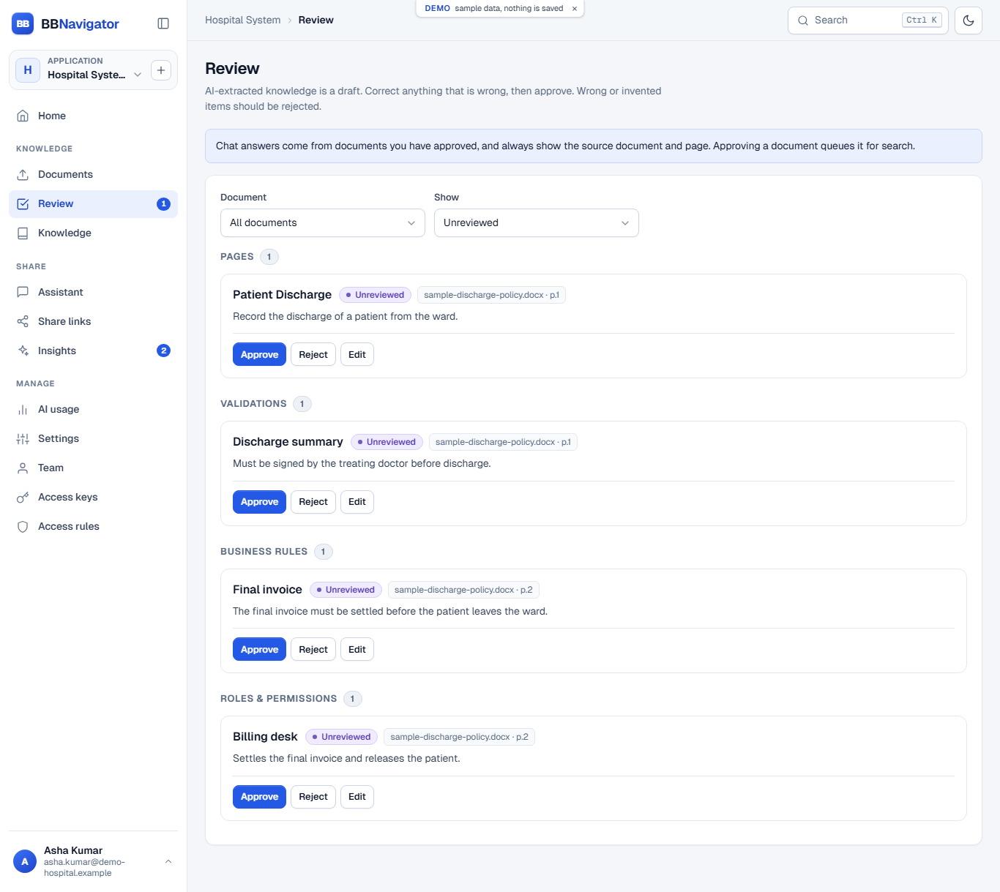
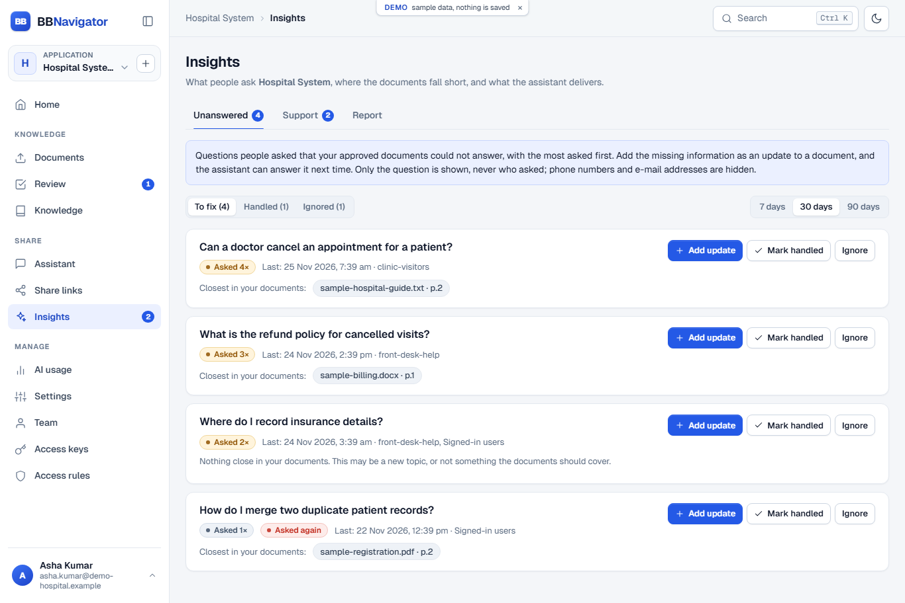
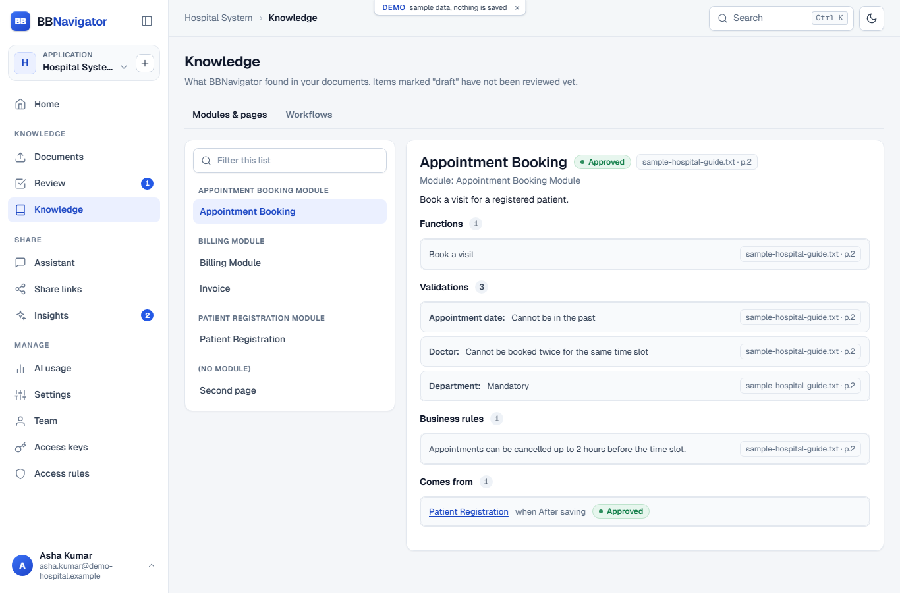
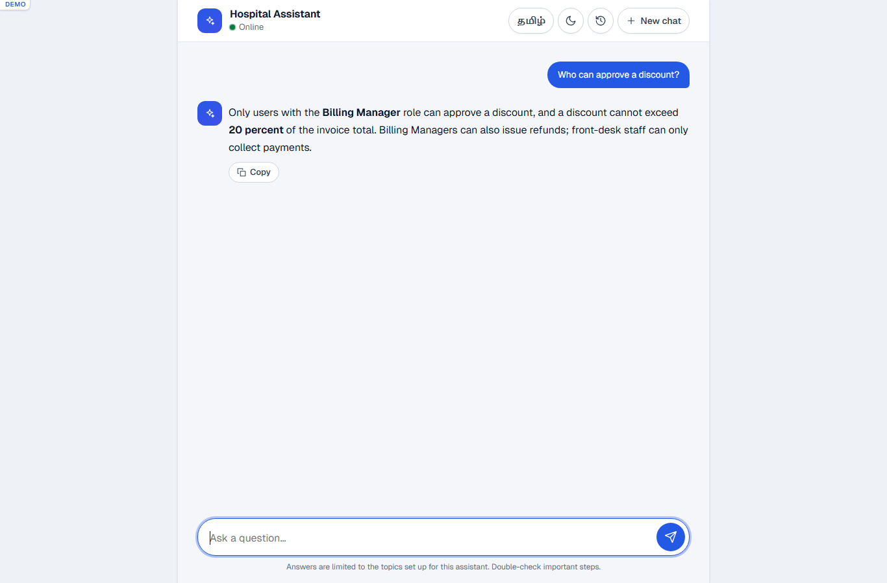

# BBNavigator – Application Knowledge Assistant

Multi-tenant, RAG-based assistant that turns uploaded application documentation into structured, searchable knowledge. Modular monolith on ASP.NET Core (net8.0), deployable to IIS.

[](https://github.com/BalachandraDev/BBNavigator/actions/workflows/ci.yml)

### Try it without installing anything
**Live demo: https://balachandradev.github.io/BBNavigator/**

It is the real web app running on sample data (a made-up hospital with three documents). On the sign-in page pick a person: **Company admin** (everything), **Front-desk user** (chat only) or **Platform admin** (all companies). Click around, ask the assistant a question, approve a review item, create a share link. Nothing is saved and no AI is called. See [How the demo works](#how-the-demo-works).

| | |
|---|---|
|  **Home**: what needs attention, this week's questions |  **Assistant**: answers only from approved documents |
|  **Review**: AI-extracted knowledge is a draft until a person approves it |  **Insights**: the questions the documents could not answer |
|  **Knowledge**: modules, pages, validations, rules and workflows found in the documents |  **Share link**: a sign-in-free chat page for visitors |

### What is in it
- **Pipeline**: upload (PDF, Word, text) → text extraction (OCR for scans) → AI analysis into reviewable knowledge (modules, pages, validations, business rules, roles, workflows) → human approval → chunking and embeddings → retrieval and chat. Answers cite the document and page, and say "not documented" instead of guessing. English and Tamil.
- **Multi-tenant by design**: the tenant always comes from the authenticated identity, never from a request field; every query is tenant-filtered, and there are tests that try to cross the boundary.
- **Access model**: audiences (groups) and per-document rules decide who may see which module or page; share links and keys follow them.
- **Accounts**: email and password sign-in with invitations and password reset (PBKDF2, lockout, sessions ended on password or role change), alongside company and platform keys for integrations.
- **Free tier only**: every AI call is counted against a configured daily allowance and stops there; nothing paid is ever used. Provider keys live only on the server.
- **Operations**: Docker Compose stack (web, worker, SQL Server, PostgreSQL + pgvector), an IIS deployment guide, health checks, an audit log, a strict Content-Security-Policy and rate limits.
- **Front end**: plain HTML, CSS and JavaScript with a token-based design system (light and dark, 320 to 1920 px, keyboard accessible). No framework and no build step.
- **Tests**: more than 500 automated tests (xUnit, WebApplicationFactory) run on every push.

### How the demo works
GitHub Pages can only host static files, so there is no server, database or AI behind the demo. The page is the unchanged front end from `src/FlowMind.API/wwwroot` plus [demo/demo.js](demo/demo.js), which answers the app's API calls from [demo/fixtures.json](demo/fixtures.json): real responses recorded from a running copy of the app, filled with made-up documents. Edits live in memory until you reload. The chat answers are canned from the sample documents; the real app uses the pipeline above. [scripts/build-pages.ps1](scripts/build-pages.ps1) assembles the site and [.github/workflows/pages.yml](.github/workflows/pages.yml) publishes it. The production app never loads the demo code.

To run the real thing, follow *Run everything with Docker* below.

## Quick start: ask a question in one call
Once an administrator has uploaded and **approved** the documents and created a **user key** (web app → *Access*), anyone can do this:

```
POST /api/ask
X-Api-Key: <user key>
Content-Type: application/json

{ "message": "What validations apply when registering a patient?" }
```
```json
{
  "answer": "Full name is mandatory. Date of birth cannot be in the future. [1]",
  "documented": true,
  "sources": [ { "document": "guide.pdf", "page": 1 } ],
  "conversationId": "29e091c2-…",
  "application": "Hospital System"
}
```
- `documented: false` means the approved documents don't cover it (the answer says so; nothing is invented).
- Follow-up: send the returned `conversationId` back with the next `message`.
- Long, messy messages (up to 8,000 characters) are fine: they are condensed locally to the real question before any AI call. When that happens the reply includes `understood` (the question that was actually asked); see *Token-saving request layer* below.
- Only if your company has several applications: add `"application": "<name>"`.
- Errors are plain: `401` bad/missing key · `400` bad request (message says why) · `409` nothing set up yet · `429` a free daily limit was reached (nothing paid is used).

PowerShell: `Invoke-RestMethod -Method Post -Uri http://localhost:5080/api/ask -Headers @{'X-Api-Key'='<key>'} -ContentType 'application/json' -Body '{"message":"hello"}'`
(with `curl.exe` on Windows PowerShell 5.1, put the JSON in a file and use `-d @body.json` — inline quotes get stripped).

Everything else in this document is setup and administration; `/api/ask` is the only call an application needs.

## Run everything with Docker
Needs Docker Desktop (about 3 GB of free memory for SQL Server). From this folder, in PowerShell:
```powershell
./scripts/init-env.ps1          # creates .env with random passwords/keys and prints your platform admin key (once)
notepad .env                    # optional: paste your AI keys + limits (leave empty to keep AI features off)
docker compose up -d --build    # builds and starts: web app + worker + SQL Server + PostgreSQL/pgvector
```
Open **http://localhost:8080** → *Platform admin* tab → the key from `.env` (`PLATFORM_ADMIN_KEY`) → create a company → sign in as the company,
create an application, upload documents, approve, then add a user key on *Access* and use `/api/ask` as shown above.

| Do this | Command |
|---|---|
| See what is running / healthy | `docker compose ps` |
| Follow logs | `docker compose logs -f api worker` |
| Stop (keeps all data) | `docker compose stop` |
| Start again | `docker compose start` |
| Apply a change to `.env` | `docker compose up -d` |
| Update after pulling new code | `docker compose up -d --build` |
| Remove containers, **keep data** | `docker compose down` |
| Remove containers **and all data** | `docker compose down -v` |
| Check health | `curl http://localhost:8080/health/ready` |

Notes: only the web app is published, and only on `127.0.0.1:8080` (change with `API_PORT` in `.env`); the databases are not reachable from outside Docker.
This stack speaks plain HTTP: for anything beyond your own machine put a TLS reverse proxy in front. It uses SQL Server *Express* (free, 10 GB limit; by
starting it you accept Microsoft's SQL Server licence terms) — to use your company's existing SQL Server instead, set `ConnectionStrings__SqlServer`
for `api` and `worker` and start only those: `docker compose up -d --no-deps --build api worker postgres`. Data lives in Docker volumes
(`sqldata`, `pgdata`, `docs`); back them up as described in [docs/OPERATIONS.md](docs/OPERATIONS.md). The container runs with `ASPNETCORE_ENVIRONMENT=Production`,
so it **refuses to start** with placeholder secrets.

## Layout
```
src/FlowMind.Domain          entities + enums (no dependencies)
src/FlowMind.Application     interfaces (IDocumentAnalysisProvider, IOcrProvider, IEmbeddingProvider, IChatProvider), DTOs
src/FlowMind.Infrastructure  EF Core (SQL Server), pgvector access, AI providers, document processing
src/FlowMind.API             controllers, middleware, Swagger, static frontend (wwwroot)
src/FlowMind.Worker          background processing (own process, not in the IIS app pool)
tests/FlowMind.Tests         xUnit + WebApplicationFactory
db/postgres                  PostgreSQL/pgvector bootstrap SQL
```
The frontend lives in `FlowMind.API/wwwroot` (plain HTML/CSS/JS) instead of a separate project: one IIS site, no CORS.

## Prerequisites
- .NET 8 SDK (net8.0 chosen: .NET 10 SDK is not installed here; 8 is LTS and its runtime is on the server)
- SQL Server (dev: LocalDB `(localdb)\MSSQLLocalDB`)
- Docker Desktop (dev PostgreSQL + pgvector)

## Run (development)
```powershell
docker compose -f docker-compose.dev-db.yml up -d   # PostgreSQL+pgvector only, on localhost:5433 (for running from source)
dotnet tool restore
dotnet ef database update -p src/FlowMind.Infrastructure -s src/FlowMind.API
dotnet run --project src/FlowMind.API --urls http://localhost:5080
```
Open http://localhost:5080 (the web app), http://localhost:5080/swagger, `/health/live`, `/health/ready`.

## Using the web app (Phase 6)
Plain HTML/CSS/JS served by the API from `src/FlowMind.API/wwwroot` (no build step, no CDN, no external requests).
1. Sign in as **Platform admin** with `Auth:PlatformAdminKey` (Docker: `PLATFORM_ADMIN_KEY` in `.env`) → **Tenants**. You see every company with its Company ID, status and counts, and can: **Show login** (Company ID = client ID, API key = password), **Reset key**, **Disable / Enable** access, or **Delete** it with all its data (you must type its Company ID). **New company** creates one and shows its login.
2. Sign out, sign in as that **Company** (Company ID + API key) → create an application.
3. **Documents:** upload; status updates by itself (extracting → AI analysing → ready for review). *Details* shows page counts and any quota note; *View text* shows extracted text per page; *Retry* / *Re-index* resume after a quota reset.
4. **Review:** correct, approve or reject extracted items, or approve the whole document (this also queues it for search).
5. **Knowledge:** browse modules → pages (functions, validations, rules, roles, next/previous pages) and workflows step by step.
6. **Assistant:** a chat window with the *BBNavigator Assistant*: it greets you, shows a typing indicator, types its answer out, and lists the source document and page under every answer (click an answer while it types to skip the animation; *Copy* copies it). If the documents don't cover a question it says so plainly. Suggested questions, conversation history, mobile layout and reduced-motion support are built in.
7. **Access (company admin):** issue a **user key** for each person/team (revocable; copy it again any time from the Keys list (stored encrypted with `Security:SecretsKey`; keys made before that was added cannot be shown again; **Replace** makes a new key with the same name and audience and revokes the old one, for a lost or leaked key)). Users sign in with the Company ID + that key and
   see only **Knowledge** (approved items) and **Chat** (their own conversations). They cannot upload, review, delete or see usage.
8. **Usage:** every AI provider's **daily limit** with a progress bar (OK / Near limit at 80% / Limit reached), how much is left, a **live countdown to its reset** (midnight Pacific for Gemini, 00:00 UTC for the others, also shown in your local time), the month-to-date use and the capacity that daily limit gives per month; plus your company's own calls and tokens (today / this month) and system health. The limits are shared by all companies on the server and renew by themselves every day. A warning banner appears when any limit passes 80%.

Security model, known limits and deployment/operations: [docs/SECURITY.md](docs/SECURITY.md), [docs/OPERATIONS.md](docs/OPERATIONS.md).
Outside Development the app refuses to start with development secrets or databases; Swagger is off unless `Swagger__Enabled=true`.

Security notes: the browser only ever holds a short-lived token in `sessionStorage` (never an AI key). All server/AI/document text is
inserted as plain text (no `innerHTML`), and a strict Content-Security-Policy (no inline script, same-origin only) is sent with every page.

Also start the background worker (separate process; extraction/OCR happen here, not in IIS):
```powershell
dotnet run --project src/FlowMind.Worker
```

## Try the Phase 2 flow (Swagger or curl)
1. `POST /api/v1/auth/token` `{ "apiKey": "<Auth:PlatformAdminKey>" }` → platform-admin JWT.
2. `POST /api/v1/tenants` `{ "name": "Acme", "slug": "acme" }` → returns the tenant `apiKey` **once**.
3. `POST /api/v1/auth/token` `{ "tenantSlug": "acme", "apiKey": "<tenant key>" }` → tenant JWT.
4. `POST /api/v1/applications` `{ "name": "Hospital System" }`
5. `POST /api/v1/documents` (multipart: `ApplicationId`, `File`) with a PDF/DOCX/TXT (synthetic samples are in `samples/`).
6. `GET /api/v1/documents/{id}/status`, `GET /api/v1/documents/{id}/pages`, `GET /api/v1/usage`.
7. If a PDF has scanned pages and OCR is blocked, status is `AwaitingOcr`; after configuring OCR call `POST /api/v1/documents/{id}/retry`.

## Phase 3: AI analysis and review
After extraction, the worker automatically queues an **analysis** job. Each document is split into ~12,000-character
windows (never the whole file); each window is sent to Gemini once and the validated response is cached by content hash
(tenant + model + prompt version), so re-analysis of unchanged content costs nothing.

Enable it (off by default — `DailyRequestLimit` 0 means "blocked"):
```powershell
$env:AiProviders__Gemini__ApiKey = "<your key>"
$env:AiProviders__Gemini__DailyRequestLimit = "<your AI Studio daily request limit, or lower>"
$env:AiProviders__Gemini__RequestsPerMinute = "<your RPM, or lower>"
# optional: $env:AiProviders__Gemini__Model = "gemini-3.5-flash-lite"; $env:AiProviders__Gemini__DailyTokenLimit = "..."
```
Set these for **both** the API and the Worker. Without them, documents stop at `AwaitingAnalysis` (nothing is sent anywhere).
When the daily quota resets (midnight Pacific) call `POST /api/v1/documents/{id}/retry`; finished sections are served from cache.

Reading and reviewing the knowledge (all tenant-scoped):
- `GET /api/v1/modules?applicationId=` — modules with their pages
- `GET /api/v1/pages/{id}` — purpose, functionalities, validations, business rules, roles, next/previous pages, source document + page
- `GET /api/v1/workflows?applicationId=` and `GET /api/v1/workflows/{id}` — ordered steps and transitions
- `GET /api/v1/review?applicationId=&status=Pending[&documentId=]` — items awaiting review
- `PUT /api/v1/review/{type}/{id}` `{ "status": "Approved|Rejected|Pending", "name": "...", "text": "..." }` — correct and decide one item
  (`type`: module, page, functionality, validation, businessrule, role, workflow)
- `POST /api/v1/documents/{id}/approve` — approve everything pending from that document

New AI output is always `Pending`; only `Approved` knowledge will be trusted by the chatbot (Phase 5). Reviewed workflows are never overwritten by re-analysis.

## Phase 4: embeddings and retrieval
When you approve a document (`POST /api/v1/documents/{id}/approve`) the worker queues an **indexing** job: the extracted
text is split into ~1,200-character overlapping chunks (a chunk never spans pages, so each has an exact page number),
embedded with Cloudflare `@cf/baai/bge-m3`, and stored in PostgreSQL/pgvector (`document_chunks`, created automatically).
Only approved documents are searchable. Re-indexing never re-embeds a chunk that is already stored; uploading a new
version replaces the old version's chunks once the new one is indexed; deleting a document purges its vectors first.

Enable it (off by default — `DailyNeuronLimit` 0 means "blocked"). Set for **both** API (query embedding) and Worker:
```powershell
$env:AiProviders__Cloudflare__AccountId = "<account id>"
$env:AiProviders__Cloudflare__ApiToken = "<token with Workers AI permission>"
$env:AiProviders__Cloudflare__DailyNeuronLimit = "5000"     # free allowance is 10,000/day; stay below it
```
If the daily limit is hit, the job stops as `QuotaExceeded` (stored chunks are kept). After 00:00 UTC call
`POST /api/v1/documents/{id}/reindex`. BBNavigator never switches to a paid model.

Try retrieval (tenant token): `POST /api/v1/search` `{ "applicationId": "...", "query": "what validations exist on discharge?", "topK": 6 }`
→ hits with `document`, `page`, `text`, `score`, `similarity`. Search is hybrid (vector + keyword, rank-fused).

## Phase 5: chat
`POST /api/v1/chat` `{ "applicationId": "...", "message": "What validations apply to registration?", "conversationId": null }`
→ `{ conversationId, answer, documented, sources: [{ document, page }] }`. Pass the returned `conversationId` for follow-ups.
- Answers come only from **approved** document excerpts retrieved for the caller's tenant + application, and must be backed by them. They are written the way ChatGPT or Claude would: one summary sentence, numbered steps with the step name in **bold**, short bullets, page and button names in **bold**. **Citation numbers and Source: lines are never shown in the text**; the document and page are listed as small source chips under the answer (and in sources of the API reply).
- If nothing relevant is retrieved, or the model says the excerpts don't answer it, or the answer cites no real source,
  the reply is a fixed "not documented" message (`documented: false`) with no sources. Nothing is guessed.
- Excerpts and questions are treated as untrusted text (delimited, injection instructions ignored); model output is only stored and returned.
- `GET /api/v1/conversations?applicationId=`, `GET /api/v1/conversations/{id}`, `DELETE /api/v1/conversations/{id}`.

Enable it (off by default — `DailyRequestLimit` 0 means "blocked"). Set for the **API** only (chat runs in the API):
```powershell
$env:AiProviders__Groq__ApiKey = "<key>"
$env:AiProviders__Groq__DailyRequestLimit = "<your Groq daily request limit, or lower>"
$env:AiProviders__Groq__RequestsPerMinute = "10"
```
Chat also embeds each question, so the Cloudflare settings from Phase 4 must be set on the API too.
When a daily limit is reached the API returns 429; nothing falls back to another model.

## Token-saving request layer (chat)
Long or messy messages never go to an AI provider as typed. Before any provider call, `/api/ask` and the Assistant pass the request through a
**local layer that makes no AI call itself** (so it spends no tokens or quota):

| Step | What it does |
|---|---|
| **Condense the message** | Removes greetings, "could you please...", thanks/signatures, quoted e-mail replies, repeated sentences and pasted bulk; keeps the actual question(s) word for word plus the short sentence before each. Numbers, identifiers, quotes and negations are never touched. Capped at `Chat__MaxQuestionChars` (400). Up to `Chat__MaxMessageChars` (8,000) is accepted. |
| **Say what was understood** | If a message was cut down substantially the reply carries `"understood": "..."` and the Assistant shows *Understood as: ...* under it. |
| **Pack the excerpts** | The model reads at most Chat__SourceChars (6,000 characters, about 1,500 tokens) of retrieved document text: best-ranked excerpts first, each kept **whole** (lines are never picked out of the middle of an excerpt), only the last one may be cut, at a line end, and lines repeated by chunk overlap are sent once. |
| **History only when needed** | A self-contained question sends no earlier messages. A follow-up sends at most `Chat__HistoryMessages` (4), user messages condensed, answers shortened to about 350 characters, "not documented" replies skipped. |
| **Reviewed workflow as a source** | For *what next / after / before / step / flow* questions (or when the question uses a workflow's or step's words) the approved workflow is added as a clean ordered outline (`1. Collection and Stickers -> 2. Dispensing -> 3. BMW Review -> ...`), cited at the page it came from. Pending or rejected workflows are never used. |
| **Citations are repaired, not discarded** | Several citation styles are understood (`[1]`, `[Source 1]`, `[1, 2]`, `【1】`). If an answer is written without any valid citation, one short repair pass asks the model to cite every statement or drop what the sources don't support; invented answers still end as *not documented*. |
| **Relevance gate** | If the best match is below Chat__MinSimilarity (0.35) no AI call is made. A *not documented* reply lists the closest sections only when they are at least Chat__RelatedMinSimilarity (0.45) similar. Both numbers were measured on a real 20-page document. |
| **Compact instructions** | The system prompt is about 40% shorter than before. |
| **Reuse answers** | The same question over the same excerpts (any user of the same company) reuses the earlier answer for `Chat__CacheDays` (14): no model call, logged as *Cached*. Editing or deleting a document changes the excerpts, so a stale answer is never reused. |

Typical cost: about 1,700-1,900 input tokens and 30-150 output tokens per answered question on a real 20-page document (the excerpt budget is the main part); repeats cost 0. A rambling 1,100-character e-mail adds almost nothing, because only its question is sent.
Set `Chat__CacheAnswers=false` to turn the cache off. The patterns are English-aware (greetings, politeness); messages in other languages still get
de-duplication, signature/quote removal and length control, and are otherwise passed through unchanged.
## Test
```powershell
dotnet test
$env:FLOWMIND_TEST_PG = "Host=localhost;Port=5433;Database=flowmind_vectors;Username=flowmind;Password=flowmind_dev_only"; dotnet test   # also runs the live pgvector test
```

## Enabling OCR (off by default)
OCR stays disabled until you set a real limit from your own Mistral account:
`AiProviders__MistralOcr__ApiKey` and `AiProviders__MistralOcr__DailyPageLimit` (e.g. 20 while testing).
BBNavigator counts pages in `AIUsageLog` and refuses requests beyond the limit; it never switches to anything else.

## Upload size under IIS
Default request limit is ~30 MB (IIS `maxAllowedContentLength`). `Upload:MaxBytes` (default 25 MB) is enforced by the app;
raise both together if you need larger files.

## Configuration
Connection strings and AI keys are server-side only. In dev use `dotnet user-secrets` or environment variables
(`AiProviders__Gemini__ApiKey`, `AiProviders__Groq__ApiKey`, `AiProviders__MistralOcr__ApiKey`,
`AiProviders__Cloudflare__AccountId`, `AiProviders__Cloudflare__ApiToken`). Never put keys in `wwwroot`.
`appsettings.Development.json` contains local-only dev credentials; production values come from environment/IIS config.

## Migrations
```powershell
dotnet ef migrations add <Name> -p src/FlowMind.Infrastructure -s src/FlowMind.API -o Database/Migrations
dotnet ef migrations script --idempotent -p src/FlowMind.Infrastructure -s src/FlowMind.API -o deploy.sql   # for production SQL Server
```

## IIS deployment (summary)
Full step-by-step guide with settings, worker service, folder permissions, backups and go-live checks: [docs/IIS-DEPLOYMENT.md](docs/IIS-DEPLOYMENT.md) (not yet run end to end on a Windows Server).

1. Install the .NET 8 Hosting Bundle; `iisreset`.
2. `dotnet publish src/FlowMind.API -c Release -o C:\inetpub\flowmind`.
3. Site + app pool with *No Managed Code*; grant the pool identity access to the storage folder.
4. Set secrets as environment variables on the app pool/site, not in files.
5. Run `FlowMind.Worker` as a Windows Service (`sc create`), separate from IIS.
6. Apply the idempotent SQL script; run `db/postgres/001_init.sql` on the company PostgreSQL.

## Privacy
Use synthetic documentation only until the company approves each external AI provider's data terms.


## Share a chat-only link

Admin sign-in -> **Share** -> *Create share link*. Send the link (`https://your-host/bot.html#t=...`) to anyone: they get only the chat
(phone, tablet or desktop), with no sign-in, no admin pages and no document names or pages in answers.

- The secret is in the `#fragment`, so it is never sent to the server or written to access logs.
- Each link covers one application of one company; the server (not the browser) decides the company.
- Per link: daily question cap (default 300), per-visitor rate limit (`Security:BotRequestsPerMinute`, default 8/min), Disable / Delete stops it at once.
- Anyone with the link uses your free AI allowance: share with trusted people and keep documents non-confidential.
- Public endpoints: `GET /api/bot/info`, `POST /api/bot/ask` (header `X-Bot-Token`). They reach nothing else.
### Customising a link
Share -> *Customize*: assistant name, welcome text, starter questions, accent colour, and **which approved documents the link may answer from**
(tick specific documents to make a per-module or per-team bot; leave "All approved documents" for everything). Create one link per person or team.
Greetings, thanks and "who are you" are answered locally; unrelated questions get a friendly "I can only help with..." reply with no AI call.
Light/dark mode: follows the device, with a toggle (sun/moon) on the chat page and in the admin bar.
### Add an update to an uploaded document
For a small change you do not need to upload the whole PDF again. On an **Approved** or **Ready for review** document press **Add update**, then paste the new or changed text (up to 20,000 characters) or upload a small PDF, DOCX or TXT with only that part (up to 2 MB and 20 pages, real text, no scanned pages). The text is attached to the end of the same document as pages headed `UPDATE <date> - <title>`. Only that new text goes through AI analysis and indexing; what is already approved stays approved, and you review and approve only the new items. If an update contradicts older text, the assistant is told to follow the newer `UPDATE` text. API: `POST /api/v1/documents/{id}/updates/text` (`{title, text}`) and `POST /api/v1/documents/{id}/updates/file` (multipart `Title`, `File`). Each update is written to the audit log.
### Insights: unanswered questions, support requests, usage report
Company admins: **Insights** in the menu (Share group). Everything is computed from the chats the assistant already stores; nothing calls an AI provider.
- **Unanswered:** the questions the documents could not answer in the last 7, 30 or 90 days, grouped (same question in different wording or capitals is one row), most asked first, with how often, when, from which link, and the closest document sections that were found. **Add update** opens the document's Add update dialog with the question as its heading (the closest document is preselected) and marks the question *handled* once the update is saved; **Mark handled** and **Ignore** record a decision. A handled or ignored question that is asked again reopens ("Asked again"). Only a hash of the question is stored for the decision, never its text.
- **Support:** when the assistant cannot answer, visitors on a share link (and signed-in ordinary users) see **Send this to our team**. They may add a note and, if they want, a contact. The question is read from their own stored chat on the server (it cannot be invented), pressing twice sends one request, a sender is limited to 5 per day and 6 per 10 minutes, and a company holds at most 500 open requests. Requests are **not e-mailed anywhere**: they wait in this inbox (the menu shows a count). Mark done with an optional note, reopen or delete. Per link switch: Share links > Customize > Chat options > *Offer "Send this to our team"*.
- **Report:** a one-page report for a period: questions asked (with the change against the previous period), the share answered from the documents, different visitors, an estimated time saved (answers x minutes per answer, which you set; stored only in your browser), questions per day, most asked questions, where people ask from, Tamil questions, documents uploaded or updated, open gaps and support requests. **Print or save as PDF** prints just the report. Greetings and thanks are not counted; off-topic questions are, as not answered.
- **Privacy:** question text shown to the admin has e-mail addresses and numbers of 7 or more digits replaced by `[email]` / `[number]`, and never says who asked. The link card still shows only a chat count. Because everything comes from stored chats, a chat that a visitor deletes (or the admin clears) also leaves these numbers and lists, and the report only reaches back as far as chats are kept (a link's retention days).
- API (company admin): `GET /api/v1/insights/gaps?applicationId=&days=`, `POST /api/v1/insights/gaps/state`, `GET /api/v1/insights/usage?applicationId=&days=`, `GET|PATCH|DELETE /api/v1/support-requests`, `GET /api/v1/support-requests/count`. Sending: `POST /api/bot/support` (share link) and `POST /api/v1/chat/support` (signed-in user). Migration `Phase10_Insights`; deleting a company removes these rows too.
### Settings: where files are stored, where data lives, activity, security
Company admins: **Manage > Settings** (the Manage menu also holds AI usage and User access).
- **Storage location (per company):** choose where NEW uploads go: *This server* (default, the private storage folder), *Cloudflare R2* (free tier, 10 GB; enter the account id, bucket and an access key) or *Your own cloud* (any S3-compatible service: MinIO on your network, Wasabi, Backblaze B2, AWS S3). A location is only saved after **Test connection** succeeds (a small file is written, read back and removed). Access keys are stored encrypted with `Security:SecretsKey`, never sent back to the browser (only the last 4 characters as a hint), and a failed test saves nothing.
- **Every file remembers where it is** (`DocumentVersion.StorageKind`: local or remote), so switching the location never strands older files, and the background worker reads each file from the right place. If the chosen cloud is unreachable an upload fails with a clear message (503); it never quietly saves somewhere else.
- **Copy existing files:** *Files already stored* copies files between this server and the cloud in small batches with a progress bar. Each copy is checked against the file's SHA-256 before it is switched over; the old copy is only removed if you tick the box. Deleting a document or a company removes its files from both places.
- **Safety:** the storage address is typed by an admin and then called by the server, so only public https addresses are accepted (no localhost, private or link-local ranges, nor names that resolve to them; checked again on every use). The server operator can allow private addresses with `STORAGE_ALLOW_PRIVATE=true` in `.env` (needed for a MinIO server on your own network). Your documents are sent to the chosen service: use synthetic or non-confidential documents until your company has approved it.
- **Local cloud (optional):** `docker compose --profile cloud up -d minio` starts a MinIO server (needs `MINIO_ROOT_USER` and `MINIO_ROOT_PASSWORD` in `.env`; the console is on http://localhost:9001, this PC only). In Settings choose *Your own cloud*, address `http://minio:9000`, region `us-east-1`, create the bucket first, and set `STORAGE_ALLOW_PRIVATE=true`. The image comes from quay.io (`quay.io/minio/minio`); pull it only if you accept that.
- **Where your data lives:** a plain list of where each kind of data is kept and how much there is. Only original files are movable from here; the SQL Server and PostgreSQL databases run on the server BBNavigator is installed on. Moving them to a cloud database is a server setting (`ConnectionStrings` in `.env`), not a company one.
- **Activity** (recent actions with who and when, from the audit log) and **Security** (a checklist: encryption secret, https, address rules, stored credentials, open access).
- API (company admin): `GET|PUT /api/v1/settings/storage`, `POST /settings/storage/test`, `POST /settings/storage/migrate`, `GET /settings/overview`, `GET /settings/activity`, `GET /settings/security`. Migration `Phase11_Storage`.

### Access rules: audiences, and who sees which module or page
Company admins: **Manage > Access rules**. There is also an *Audience* choice on **User access** (per key) and on each share link.
- **Audiences** are groups such as Manager, Nurse, Ward (Quick start offers the roles your documents already mention and a few common hospital groups). A key or link **with no audience keeps full access**, so every existing key behaves exactly as before until you assign one. An audience can list other words the documents use for it ("sister, charge nurse"), which only helps the suggestions.
- **Rules** say who may see a *module*, a *page*, or the *other document pages* (introductions, glossaries: pages no module or page was taken from). Each is *Everyone*, a list of audiences, *Admins only* (nobody ticked) or *Not decided*. Rules are explicit and never inherited: ticking a module in the grid also ticks its pages, but each can then be changed alone. **Not decided is closed to audiences** (only full-access keys and admins see it), so a newly extracted page never becomes visible by accident.
- **How a document page is decided:** every extracted item (module, page, its functions, validations, rules, role facts, workflows) records the document page it was taken from. A document page is open to an audience only if **every** item that cites it is open to that audience (the stricter rule wins; the grid marks pages that share document pages). Pages no item cites follow the document's own rule. A workflow is shown only if its module and every page it walks through are open. Rejected items count for nothing.
- **Enforced on the server, before the AI sees anything:** chat (`/api/v1/chat`), the one-call `POST /api/ask`, `POST /api/v1/search`, the Knowledge pages (a hidden page or workflow is a 404, exactly like one that does not exist) and share links with an audience. For restricted callers the page limit is part of the search query itself (a hidden page is never a candidate, never ranks, never read back), so its text is never sent to the AI provider. Cached answers are keyed by the excerpts used, so one audience's answer is never replayed to another.
- **Making it easy:** the page is organised by document. Pick a document at the top (each shows how many of its parts are still not decided), then tick who may see each module and page. The first row, **Whole document**, sets everything at once; the rows below fine-tune single modules and pages (ticking a module ticks its pages, and a mixed marker shows when they differ). Audiences are added in a small dialog (first time: a setup card with one-click groups from your documents and common hospital roles). Also: search, a *Not decided* filter, an unsaved-changes bar (nothing changes until **Save changes**; leaving the page warns), **What can they see?** (a preview computed with exactly the logic chat uses), and **Suggest from document**: it reads the role/permission facts already extracted from your documents ("Nurse: can view and update"), matches the role words to your audiences, treats "no access / cannot / not allowed" as a refusal, and fills the grid as an unsaved draft for undecided items only. It makes no AI call and cannot be steered by document text; you review it and press Save.
- **Limits worth knowing:** a hidden question gets the normal "not documented" reply (the server cannot say "it exists but not for you" without revealing it). Rule changes reach keys and links within about 15 seconds. Earlier chats are not rewritten when you tighten a rule. Suggestions only know what the extraction found: refusals ("Nurse has no access") are not always extracted, so check the grid. If the extraction attributes an item to the wrong document page, that page is only ever hidden more, never less; the preview shows the result. Re-analysing a document reuses modules and pages by name, so their rules stay; new ones start undecided. This controls what BBNavigator answers, not what staff can do inside your HMIS.
- **"What can I ask?":** questions about coverage ("what can I ask", "what data can be shown", "what is approved for me to search", "list the modules") are answered by the assistant itself with the list of modules and pages that caller may see (their audience, and for a share link its documents). No AI call, no document search, never the "not documented" card, and nothing hidden is named. Real questions that merely contain similar words ("what can I see on the dashboard page", "which pages show the validation rules") still go to the documents. The "not documented" card tells people to type "what can I ask?".
- **Rules apply only to keys and links that have an audience.** A share link or key with no audience answers from everything approved (full access), exactly as before audiences existed, so creating an audience and ticking pages does nothing for it until you assign the audience (Share links > Customize > Audience, or User access > the key's audience). The Access rules page now shows a notice listing the active links and keys that still have full access, with shortcuts, and a share link without an audience shows a "Full access: no audience" chip once your company has audiences.
- **Chat only, or chat plus Knowledge page (per audience):** people who sign in with a key see the Assistant and, if allowed, the Knowledge page. For a key with an audience the Knowledge page is **off by default**, so they get the chat alone; tick "Also let them open the Knowledge page" in Access rules > Audiences > Edit to give it to that audience (it still shows only what the rules open). Keys with no audience (full access) and company admins keep both. This is enforced on the server too (the knowledge endpoints answer 403 for a chat-only key), not only by hiding the tab. Share links open the chat page only, so there is no Knowledge tab on a link; choose its audience under Share links > Customize. Existing audiences become chat-only when this update is applied (migration `Phase14_AudienceBrowse`, additive). `GET /api/v1/me/access` tells the app which pages to show.
- **Token use per share link:** every AI call a link's visitors cause (the chat answer, the search embedding, a citation retry) is stamped with that link, from the validated link and never from the visitor. **AI usage > Each share link** shows, for 7, 30 or 90 days: questions, AI calls, tokens in, tokens out, total, share of all chat tokens, average tokens per AI call and search units, plus the tokens that did not come from a link (your Assistant page and access keys) so the totals add up. Each card on **Share links** also shows its last 30 days. Deleted links keep their history ("(deleted link)"). Greetings, "what can I ask?", off-topic replies and repeated questions served from memory make no AI call, so they add no tokens. Only usage from now on is attributed (older records carry no link). `GET /api/v1/bot-links/usage?days=30`; migration `Phase15_LinkUsage` (a nullable column and an index).
- **Folder on a server (instead of a cloud account):** Settings > Storage now has a third option, **Folder on a server**, for a folder on the IIS machine or a file share (for example `D:\FlowMindDocs` or `\\fileserver\BBNavigator`). The admin types the full path; **Test folder** writes, reads back and removes a tiny file, and the setting is saved only if that works. New uploads then go to `{folder}\{company}\{document}\v{n}\original.ext`, older files keep opening from wherever they are, and **Files already stored** can copy files to or from the folder (checked against each file's SHA-256). It needs no cloud account and no encryption key. **Safety:** a typed path can reach any folder the app's account can reach, so the server operator must list the allowed locations first in `Storage:AllowedFolderRoots` (environment: `Storage__AllowedFolderRoots__0`, `__1`, ...). Empty (the default) = the option is switched off. A path must be absolute, contain no `..`, and lie inside one of those roots; it is re-checked on every use, the folder must already exist (a typo never creates one), and only a company's own sub-folders are ever deleted, never the chosen folder. **Permissions:** the account that runs BBNavigator (on IIS, the application pool identity) needs Modify permission on the folder, and for a share both the share and folder permissions. **Docker:** set `STORAGE_FOLDER_ROOT=/shared-docs` in `.env` and mount the folder into the `api` and `worker` services; the app cannot see a Windows path from inside a Linux container. Migration `Phase16_FolderStorage` (one column, additive).
- **No storage words in replies:** visitors are never told how the knowledge is kept. The assistant's rules forbid the words source, document, documentation, PDF, file, excerpt and citation, and phrases like "according to" or "listed in" them. A safety net also rewrites any that slip through ("listed in the BMW module documentation, each with a source citation" becomes "listed in the BMW module"; "According to the sources, X" becomes "X"). Only phrases that point at the storage are touched, so a real feature such as "upload the patient documents" is left alone. The fixed replies (greeting, not found, outside what I can help with), the share-link footer and the welcome line are worded the same way. The admin's own Assistant page still shows its Sources list, since the admin needs it.
- **Unrelated questions:** plainly off-topic messages (weather, jokes, sports, news and prices, general knowledge, arithmetic, "write me a poem or code", "are you ChatGPT") are recognised locally, in English and Tamil, and answered with a short message that names the application and says what can be asked. No search and no AI call (so no free-tier quota is used), and they are not counted as unanswered documentation gaps in Insights. The patterns are deliberately narrow, and there is a second safety net: if the search finds nothing close to a question in the approved documents (similarity below 0.45) and the model cannot answer it, the question is treated as unrelated in the same way (a song, a recipe, a stray word) and gets the same reply. The reply is specific: it names the modules that caller can ask about ("I only answer relevant questions about the BMW module", or "the BMW and Ward modules"), never file names. The list follows the same limits as search: only the share link's documents, and only the modules that caller's audience may see. **Insights > Unanswered lists only questions about topics the documents come close to** (the closest sections are shown with each), so the admin reviews real documentation gaps, not noise. A question the documents nearly cover but do not answer still gets "not documented", the closest sections, the "Send this to our team" offer and a place in Unanswered.
- API (company admin): `GET|POST /api/v1/access/audiences`, `PUT|DELETE /api/v1/access/audiences/{id}` (refused while an active key or link uses it), `GET /access/overview?applicationId=`, `PUT /access/rules` (all or nothing, every id checked against the company), `GET /access/suggestions`, `GET /access/preview`, `GET /access/roles-found`; `PATCH /api/v1/access-keys/{id}` moves a key; share links take `audienceId` / `noAudience`. Migration `Phase12_Access` (additive). Deleting a company removes its audiences and rules.

### Share link design and history
See DEVLOG 'Share links v2'. Admins: Share links > Customize > Design / Chat options. Visitors: the clock icon opens their own chat history and can delete one chat or all of them. Admins: each link card has **Clear chat history (n)**, which erases every visitor's stored chats for that link (the card shows only the count; the Insights page shows the questions the assistant could not answer, text only and without who asked); deleting a link erases its chats too.

### Tamil + English
See DEVLOG 'Tamil + English'. Settings: Chat__TamilProvider, Chat__MinSimilarityTamil, Chat__TamilMaxOutputTokens, AiProviders__Gemini__ChatModel.


### Approving server folders (platform admin)

"Folder on a server" no longer needs a server setting. The platform administrator opens **Companies > Server folders for company files** and approves a location once (for example `D:\FlowMindDocs` on the IIS machine, or `\\fileserver\BBNavigator`). The folder must exist, may not be a whole drive or a system folder, and a test file is written and removed to prove the BBNavigator account can use it. A company admin then types a folder inside an approved location in **Settings > Storage** and can copy or move the files already uploaded: **Move** removes each file from the old place once the new copy's checksum matches, and from then on BBNavigator opens it from the folder. A location cannot be removed while a company still uses it. Locations set in server configuration (`Storage__AllowedFolderRoots__0`, `STORAGE_FOLDER_ROOT`) are always allowed too.
**In Docker:** the `api` and `worker` containers see a folder called `/shared-docs` (a Docker volume by default, or a real folder on your PC when `STORAGE_HOST_FOLDER=D:/FlowMindDocs` is set in `.env`). Approve `/shared-docs` once under Companies > Server folders, then companies type `/shared-docs` or a folder inside it in Settings > Storage. A Windows path such as `D:\FlowMindDocs` typed directly is only meaningful when BBNavigator itself runs on Windows/IIS.

## Accounts: email and password sign-in

People sign in with **their own email and password**, like any web service. The email identifies the person and their company, so there is no company ID to remember. Company, user and platform **keys still work** (for integrations through `X-Api-Key`, and the platform key as the emergency way in).

- **First admin of a company:** when you create a company (Companies > New company) enter the admin's email. They get a link to choose their own password. Existing companies: sign in once with the company key, open **Team**, and invite yourself as Admin.
- **Team page (company admins):** invite people, give them a role (Admin or User) and a group (audience), switch someone off (their session ends within seconds), reset a password, delete. A company always keeps at least one active admin.
- **My account:** change your name and password, and sign out everywhere (ends every other session).
- **Forgot password?:** on the sign-in page. The answer is the same whether or not the email has an account. The emailed link works once and expires in 30 minutes; invitations last 7 days. Choosing a new password ends all old sessions.
- **Passwords:** at least 10 characters, not a common password, not built from the email or name. Stored only as salted PBKDF2-SHA256 hashes (600,000 iterations). Five wrong attempts lock the account for 15 minutes.
- **Platform admins** can have email accounts too (Companies > Platform admins), so the platform key is no longer shared around.

### Sending the emails
BBNavigator sends invitations and reset links through an SMTP account you provide. Without one **nothing is emailed**: the Team page shows the link for the admin to pass on, and "Forgot password?" tells people to ask their admin. Set these in `.env` (names for Docker; on IIS use the same names as `Email__Host` and so on):

```
EMAIL_HOST=smtp.yourcompany.com
EMAIL_PORT=587
EMAIL_USER=flowmind@yourcompany.com
EMAIL_PASSWORD=...            # for Gmail or Outlook.com use an app password, not your normal one
EMAIL_FROM=flowmind@yourcompany.com
PUBLIC_URL=https://flowmind.yourcompany.com
```

Then `docker compose up -d`. Use an address you control and an account your organisation approves for sending; hospital email policies often require their own mail relay.